**[Browse icons](https://animateicons.in/icons/lucide)** &nbsp;&nbsp;·&nbsp;&nbsp; **[Docs](https://animateicons.in/icons/docs)** &nbsp;&nbsp;·&nbsp;&nbsp; **[MCP](https://animateicons.in/icons/docs/mcp)** &nbsp;&nbsp;·&nbsp;&nbsp; **[Sponsor](https://github.com/sponsors/Avijit07x)**

<p>
  <a href="https://www.npmjs.com/package/@animateicons/react"></a>
  <a href="https://github.com/Avijit07x/animateicons/stargazers"></a>
  <a href="https://github.com/Avijit07x/animateicons/graphs/contributors"></a>
  <a href="https://github.com/Avijit07x/animateicons/commits"></a>
  <a href="./LICENSE"></a>
  <a href="https://vercel.com/open-source-program"></a>
</p>

---

1,449 animated SVG icons with hover and imperative triggers, and configurable size, color and duration. Built on `motion`.

## Quick start

```bash
pnpm add @animateicons/react
```

```tsx
import { BellRingIcon } from "@animateicons/react/lucide";

export function Notifications() {
	return <BellRingIcon size={24} color="#f45b48" />;
}
```

Icons animate on hover by default, and `motion` is bundled. Import from `@animateicons/react/lucide` or `@animateicons/react/huge`.

Prefer to own the code? Copy one icon into your project with `npx animateicons add bell-ring`.

## Other frameworks

The same icons and the same motion ship for more than React:

| Framework                                      | Package                                                                        | Docs                                                   |
| ---------------------------------------------- | ------------------------------------------------------------------------------ | ------------------------------------------------------ |
| Plain JS, web components, Svelte, Solid, Astro | [`@animateicons/vanilla`](https://www.npmjs.com/package/@animateicons/vanilla) | [Plain JS](https://animateicons.in/icons/docs/vanilla) |
| Vue 3 and Nuxt                                 | [`@animateicons/vue`](https://www.npmjs.com/package/@animateicons/vue)         | [Vue](https://animateicons.in/icons/docs/vue)          |
| Angular 20, 21 and 22                          | [`@animateicons/angular`](https://www.npmjs.com/package/@animateicons/angular) | [Angular](https://animateicons.in/icons/docs/angular)  |

## Props

| Prop         | Type      | Default        |
| ------------ | --------- | -------------- |
| `size`       | `number`  | `24`           |
| `color`      | `string`  | `currentColor` |
| `duration`   | `number`  | `1`            |
| `isAnimated` | `boolean` | `true`         |
| `className`  | `string`  | -              |

## Hover, click or both

> [!TIP]
> Use `useIconHover` to play an icon when a user hovers or clicks the button, link or card around it.

```tsx
"use client";
import { useIconHover } from "@animateicons/react";
import { BellRingIcon } from "@animateicons/react/lucide";

export default function Bell() {
	const { ref, triggerProps } = useIconHover(); // hover (default)

	return (
		<button {...triggerProps}>
			<BellRingIcon ref={ref} size={28} />
		</button>
	);
}
```

See the [full docs](https://animateicons.in/icons/docs/examples/hover-helper) for click, both and multiple icons.

## Documentation

Read the [documentation](https://animateicons.in/icons/docs) for the CLI, shadcn, MCP, styling and the full API.

## Contributing

PRs adding icons are welcome. See [CONTRIBUTING.md](./CONTRIBUTING.md).

## License

[MIT](./LICENSE). Icon shapes are based on [Lucide](https://lucide.dev) and [Hugeicons](https://hugeicons.com), see the [third-party notices](./THIRD_PARTY_NOTICES.md).
